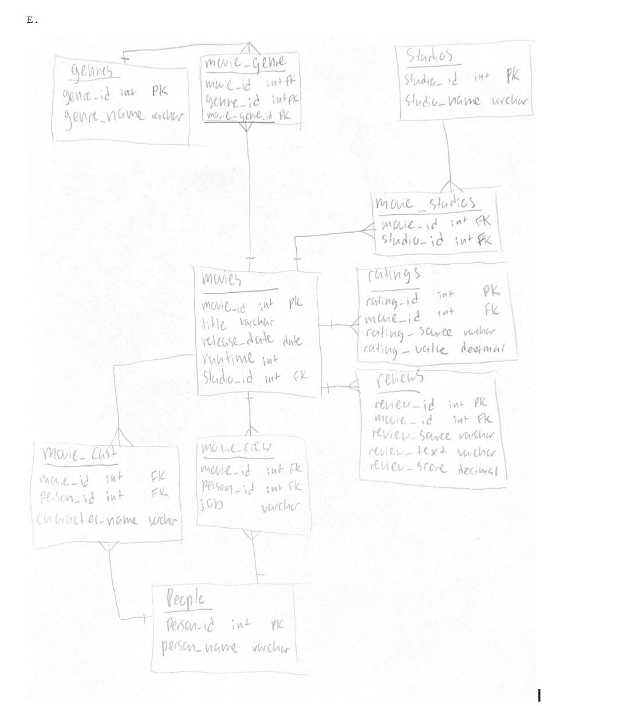

Documentation:

Team: Cinematic Schema | Course: DAT 153: Database Programming | Sprint: 03 (draft, October 17, 2026)
Team review required before submission. This is a proposed normalized design based on Sprint 02, not a verified description of a deployed database. The original Sprint 02 ER diagram, exact columns, and instructor review notes were not provided. Check the proposed columns against your source API and ensure the final diagram, documentation, and CREATE TABLE scripts match exactly.

_List each teammate, then record who held each role every sprint._

| Sprint | Product Owner | Scrum Master | Developer |
|--------|---------------|--------------|-----------|
| 01     | David         | Andrea       |  Nicole   |
| 02     |  Andrea       | Nicole       | David     |
| 03     |       Nicole  | David        | Andrea    |
| 04 | | | |
| 05 | | | |
| 06 | | | |

Our Movie Review Aggregation and Analytics Platform organizes movie titles, release dates, genres, people involved in cast and crew, production studios, aggregate ratings, and written reviews. Movie viewers could compare movies and explore trends by genre, year, actor, director, or studio.
Planned source: The Movie Database (TMDb) API: https://developer.themoviedb.org/docs/getting-started. Sprint 02 also considered IMDb developer resources and Rotten Tomatoes, but neither was confirmed as an accessible source. We must verify access, field names, API terms, and rating/review coverage before ETL in Sprint 04. No data has been collected or validated as part of this document.

Proposed source information Destination Status / note
Movie identifier, title, release date, overview movies  TMDb candidate; confirm fields and identifier policy
Genre identifier and name   genres  TMDb candidate
Movie-to-genre assignments  movie_genre Derive from movie genre lists
Person identifier and name  people  TMDb candidate; first/last name parsing is not guaranteed
Movie cast and character    movie_cast  TMDb candidate; design assumes one cast row per movie/person
Movie crew and job  movie_crew  TMDb candidate; job names need consistent handling
Production company / studio studios TMDb candidate; confirm semantics of "studio"
Movie-to-studio assignments movie_studio    Derive from movie production companies
Aggregate rating and vote count ratings TMDb candidate; source-specific scale must be documented
Individual written review   reviews TMDb candidate; verify review coverage and fields
Age/content certification   movies.content_rating   Proposed based on Sprint 02 instructor note; confirm source and territory

Real versus fabricated data: The intent is to use real external movie metadata. Whether individual reviews and certifications are available for the selected movies is not yet confirmed; any fabricated data must be labeled and approved by the team and instructor. The deployed database remains empty in Sprint 03.

## Database design

Our Cinematic Schema database organizes information about movies, genres, actors, crew members, studios, ratings, and reviews. We designed the database to follow Third Normal Form (3NF) to reduce redundancy and prevent inconsistencies. Our design contains 10 tables, including bridge tables that represent many-to-many relationships.

A. Functional Dependencies

Each table has the following functional dependencies:

Table

Functional Dependencies

movies

$${movie\_id} → title, release\_date, runtime, studio\_id$$

genres $${genre\_id} → genre\_name$$ 

people

$${person\_id} → name$$

studios

$${studio\_id} → studio\_name$$

ratings

$${rating\_id} → movie\_id, rating\_source, rating\_value$$

reviews

{review_id} → movie_id, review_source, review_text, review_score

movie_cast

{movie_id, person_id} → character_name

movie_crew

Composite key (movie_id, person_id, job); no additional nontrivial dependencies

movie_genre

Composite key (movie_id, genre_id); no additional nontrivial dependencies

movie_studios

Composite key {movie_id, studio_id}; no additional nontrivial dependencies

We also considered whether (movie_id, rating_source) uniquely determines rating_value. This would apply if we store only one rating per movie from each source. Genre and studio names may also be unique identifiers if we enforce uniqueness constraints.

B. Normal Form Checks

1NF: All ten tables satisfy the First Normal Form because each column contains a single value. Multiple genres, actors, and studios are represented through separate bridge tables instead of lists within the movies table.

2NF: The movies, genres, people, studios, ratings, and reviews tables have single-column primary keys, so partial dependencies are not possible. The bridge tables use composite keys. In movie_cast, character_name depends on the movie–person combination, assuming one cast record per actor per movie. The remaining bridge tables contain only key attributes, so they have no partial dependencies.

3NF: Non-key attributes depend on their table's key rather than on other non-key attributes. For example, actor names are stored in people rather than movie_cast, and studio names are stored in studios rather than movie_studios. This avoids transitive dependencies and unnecessary repetition.

C. Resolving Sprint 02 Flags

We revisited several design concerns from Sprint 02:
Resolved: We combined the original actors and crew_members tables into people because individuals can have both acting and production roles.
Resolved: We included a job in the movie_crew composite key to allow one person to perform multiple jobs on the same movie.
Resolved: We clarified the difference between ratings, which stores numerical ratings from different sources, and reviews, which stores individual written reviews.
Not a problem: We retained movie_genre and movie_studios because they correctly represent many-to-many relationships.
We did not deliberately denormalize any tables.

D. 

While we made adjustments, we did not denormalize any tables from the database plan to reach 3NF. However, a design we considered before Sprint 02 included having all our movie crew members' roles and names listed in their own table.

Movie_crew
| Person_id (PK) | Name | Movie_id (FK) | job |
|---|---|---|---|
| 1001 | Kent Johnson | 1234 | Cameraman |
| 1002 | Elizabeth Winter | 1234 | Director |
| 1003 | Kent Johnson | 1235 | Editor |
| 1004 | Cleo Beckett | 1235 | Sound Engineer |

If a table with person_id as a primary key that also lists people's names is not its own table, this causes an update anomaly. If a person changes their name and is listed multiple times because they worked on different movies or had different roles in the same movie, then all those names/rows would need to be independently updated. For example, if Kent Johnson wanted to change his last name to West, it would need to be updated in multiple rows. 
Movie_Crew
| Person_id (FK) | Movie_id (FK) | job |
|---|---|---|
| 1001 | 1234 | Cameraman |
| 1002 | 1234 | Director |
| 1003 | 1235 | Editor |
| 1004 | 1235 | Sound Engineer |

People
| Person_id (PK) | Name |
|---|---|
| 1001 | Kent Johnson |
| 1002 | Elizabeth Winter |
| 1003 | Kent Johnson |
| 1004 | Cleo Beckett |

In this design, if Kent Johnson wants to change his last name, only one update needs to be made to his row in the People table. 

### E. Schema Design

 

Changes Made:
We combined the original actors and crew_members tables into people because individuals can have both acting and production roles. We included a job in the movie_crew composite key to allow one person to perform multiple jobs on the same movie. We clarified the difference between ratings, which stores numerical ratings from different sources, and reviews, which stores individual written reviews.

## Acknowledgments

The team consulted the DAT 153 Sprint 03 instructions and SQL4DS normal forms material. The Movie Database (TMDb) developer documentation is a proposed source reference, not yet a confirmed dataset. ChatGPT assisted with drafting and proposing a normalized schema; all design choices and source assumptions require team verification.

